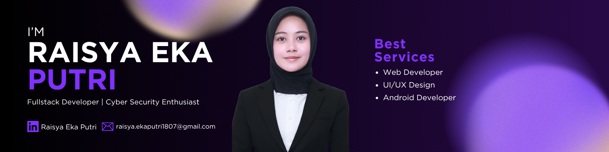

<!--
  GitHub Profile README
  Replace all placeholders before publishing.
-->

# Hi, I'm Raisa 👋

### Full-Stack Developer | Cybersecurity Enthusiast

Building useful applications with clean interfaces, reliable functionality, and security in mind.

---

## 👩🏻‍💻 About Me

I'm an Informatics student at **President University**, focusing on software development and cybersecurity.

I have experience working on full-stack web applications, Android development, and security-related projects through collaborative projects and my internship as a Software Developer at PT Denso Indonesia.

I enjoy turning ideas into functional applications, learning new technologies, and building solutions that balance usability, maintainability, and security.

- 🎓 Informatics student at President University
- 💻 Interested in Full-Stack Development and Cybersecurity
- 🏢 Software Developer Intern at PT Denso Indonesia
- 🤝 Experienced in collaborative software projects
- 🌱 Continuously learning and improving my technical skills

---

## 🛠️ Tech Stack

### Languages

### Web Development

### Database & Tools

### Areas of Interest
- Full-Stack Web Development
- Mobile Application Development
- Cybersecurity and Security Assessment
- Digital Signature and Document Verification
- UI Design and Prototyping

---

## 🚀 Featured Projects

### 🔐 DigiSign — Digital Signature & Document Verification

A web application for digital signature verification and document integrity checking in company approval workflows.

- **Role:** Full-Stack Developer
- **Tech:** PHP, Laravel, Tailwind CSS, Cryptographic Hashing
- **Focus:** Document integrity and digital signature verification

[View Repository](YOUR_DIGISIGN_REPOSITORY_URL)

### 🛡️ AI-Assisted Cybersecurity Risk Assessment Platform

A platform designed to support cybersecurity risk assessment through an AI-assisted approach.

- **Role:** Frontend Developer
- **Tech:** React, JSX, Node.js, Tailwind CSS, Python
- **Focus:** User interface and cybersecurity risk assessment workflows

[View Repository](YOUR_CYBERSECURITY_PROJECT_REPOSITORY_URL)

### 💼 Tinjob — Job Portal & CV Analysis

A full-stack web application combining job vacancy information with CV analysis functionality.

- **Role:** Full-Stack Developer
- **Tech:** React, Node.js, Tailwind CSS, Python
- **Focus:** Job search and CV analysis

[View Repository](YOUR_TINJOB_REPOSITORY_URL)

### 🍔 Grabigo — Android Food Delivery App

An Android application developed to support a food delivery workflow.

- **Role:** Full-Stack Developer
- **Tech:** Java, Kotlin, Firebase
- **Focus:** Mobile application development

[View Repository](YOUR_GRABIGO_REPOSITORY_URL)

---

## 💼 Experience

### Software Developer Intern — PT Denso Indonesia

- Analyzed HR business processes and identified problems in existing workflows.
- Reviewed related documents and requirements to support system development.
- Created UI mockups in Figma based on business needs.
- Developed application features based on the analyzed requirements.
- Supported offline recruitment test operations.

### Organizational Experience

**PUMA IT**
- Contributed to event branding, social media content, and media documentation.

**COMPSPHERE 2025**
- Served as a Liaison Officer for a Faculty of Computer Science competition.

**ELIF**
- Served as PIC Design, working on logos, Instagram feeds, and posters.

---

## 📊 GitHub Statistics

---

## 🤝 Let's Connect

I'm open to collaboration, software development projects, and opportunities to learn and grow as a developer.

- **GitHub:** https://github.com/YOUR_GITHUB_USERNAME
- **LinkedIn:** YOUR_LINKEDIN_URL
- **Email:** YOUR_EMAIL

*Thanks for visiting my profile! ✨*

