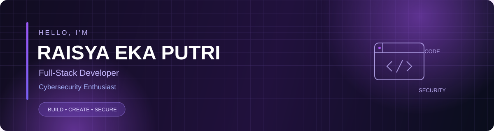

### Full-Stack Developer | Cybersecurity Enthusiast

Building useful applications with clean interfaces, reliable functionality, and security in mind.

---

## 🟣 ABOUT ME

<table>
<tr>
<td width="60%" valign="top">

### Hello, I'm Raisya! 👋

I'm an Informatics student at **President University**, interested in software development and cybersecurity.

I enjoy developing applications, designing intuitive interfaces, and exploring how technology can solve real-world problems.

Currently, I'm growing my experience through academic projects, collaborative development, and my internship as a Software Developer.

- 🎓 Informatics — President University
- 💻 Full-Stack & Application Development
- 🔐 Cybersecurity & Security Assessment
- 🏢 Software Developer Intern
- 🤝 Open to collaboration and freelance opportunities

</td>
<td width="40%" valign="middle" align="center">

  

  

</td>
</tr>
</table>

---

## 🧩 TECH STACK

### Programming Languages

### Frontend & Backend

### Database & Development Tools

### Other Interests

`Cybersecurity` `Penetration Testing` `Security Auditing`
`Digital Forensics` `UI/UX Design` `Mobile Development`

---

## 🚀 FEATURED PROJECTS

<table>
<tr>
<td width="50%" valign="top">

### 🔐 DigiSign

**Digital Signature & Document Verification**

A web-based digital signature and document verification system for company approval workflows.

- Full-Stack Developer
- PHP & Laravel
- Tailwind CSS
- Cryptographic Hashing

[View Repository →](YOUR_DIGISIGN_REPO_URL)

</td>
<td width="50%" valign="top">

### 🛡️ AI Cybersecurity

**AI-Assisted Risk Assessment Platform**

A project focused on supporting cybersecurity risk assessment through an AI-assisted approach.

- Cybersecurity
- Risk Assessment
- AI-assisted approach

[View Repository →](YOUR_CYBERSECURITY_REPO_URL)

</td>
</tr>
<tr>
<td width="50%" valign="top">

### 💼 Tinjob

**Job Portal & CV Analysis**

A platform combining job vacancy information and CV analysis functionality.

- Full-Stack Development
- Web Application
- CV Analysis

[View Repository →](YOUR_TINJOB_REPO_URL)

</td>
<td width="50%" valign="top">

### 🍔 Grabigo

**Android Food Delivery Application**

An Android application developed as a collaborative software project.

- Android Development
- Java / Kotlin
- Firebase

[View Repository →](YOUR_GRABIGO_REPO_URL)

</td>
</tr>
</table>

---

## 💼 EXPERIENCE

<table>
<tr>
<td width="100%">

### Software Developer Intern

**PT Denso Indonesia**

- Analyzing HR business processes and existing workflows.
- Reviewing business requirements and supporting documentation.
- Designing UI mockups using Figma.
- Developing application features based on requirements.
- Supporting offline recruitment test operations.

</td>
</tr>
<tr>
<td width="100%">

### Organizational Experience

**PUMA IT** — Branding, social media, and media documentation.

**COMPSPHERE 2025** — Liaison Officer Committee.

**ELIF** — PIC Design, responsible for visual design materials.

</td>
</tr>
</table>

---

## 📊 GITHUB ANALYTICS

---

## 🤝 LET'S CONNECT

I'm always interested in learning, building new things, and collaborating on meaningful projects.

**Have an idea? Let's build something together!**

  

*Thanks for visiting my profile! ✨*

